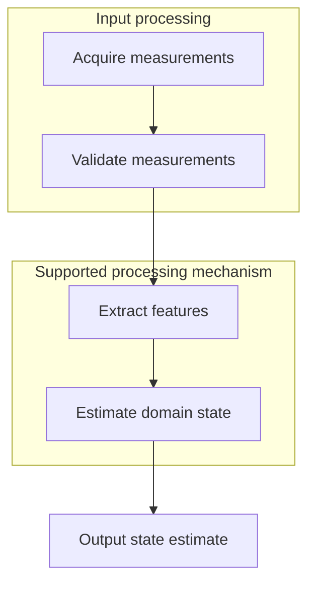

# Technical disclosure chapter template

<!-- English edition: modified 2026-10-20; see EDITION-NOTICE.md at package root. -->

Apply the case-specific evidence and the conventions in `disclosure_builder.md`.

## Header and notes

Include the invention title, supplied technical contact details, and intended patent category. Use `[TO CONFIRM]` for unknown information. Explain the background and solution clearly enough for an inventor and patent professional to assess the implementation. Avoid suggesting that a complete template establishes filing readiness.

## 1. Background and closest prior art

### 1.1 Prior-art comparison

Group relevant records by technical approach. For each, give its identifier and title, a source-supported mechanism summary, application, limits, and a verified public URL matching the record. Read the abstract or public technical text before comparison. Include the actual databases and substantive queries used, then summarize the supported difference of this invention. Keep internal script and tool-routing details out of this chapter.

### 1.2 Limitations of existing approaches

Link each stated limitation to the relevant record and the technical problem. Distinguish a documented limitation from an inference or an untested expectation. Avoid claiming no prior solution exists because a limited search found none.

## 2. Technical problem

State the concrete technical problem addressed by the supplied mechanism. Link it to Chapter 1 and prepare the explanation of the detailed solution; do not substitute a business objective for the technical operation.

## 3. Detailed technical solution

### 3.1 Context

Describe the application and prerequisites, including any necessary human judgement or input-quality assumptions. Anonymize confidential names consistently without inventing technical facts.

### 3.2 System diagram

Use a fenced Mermaid graph with functional module names and explicit dependencies. For example:

Replace this illustrative graph with the source-supported mechanism; the example is not evidence for an invention. Render with `scripts/disclosure/mermaid_render.py` and embed the PNG in Word. Preserve the source fence in Markdown.

### 3.3 Module functions and relationships

Explain each module's role and its upstream/downstream data, control, and feedback relationships. Document implementation inputs and outputs where necessary to understand operation rather than listing interfaces without a technical explanation.

### 3.4 Process

Create a source-supported Mermaid flowchart, explain each numbered step, and connect it to the proposed claim architecture. Describe branches and conditions that affect the concrete output. Do not replace the diagram with ASCII arrows.

### 3.4.1 Symbols and equations

Define symbols first, then state source-supported equations and their technical interpretation. A symbol table contains symbol, meaning, index meaning, units, and range. Keep dimensions in upright subscripts: `b_{i,\mathrm{cpu}}`, not `b_i^{cpu}`. Use distinct letters for unrelated quantities. Keep the same form and meaning in all later equations, the parameter table, and embodiments.

For a relevant and supported scheduling example, `i` may index tasks and `j` nodes, while `b_{i,\mathrm{cpu}}` denotes a positive dimensionless CPU-demand weight. This example does not authorize inventing a scoring formula. Use one delimiter and equation-numbering convention throughout. Check signs, bounds, dimensions, denominators, and correspondence to the flowchart.

### 3.5 Parameters

State meanings, valid ranges, source basis, and constraints for thresholds and algorithm parameters. Include a symbol column identical to 3.4.1. Identify values as measured, configured, proposed, or unresolved. Keep embodiment values consistent.

## 4. Supported advantages

Link each technical effect to the relevant operation and evidence. Distinguish demonstrated, analytically supported, and hypothesized effects. Avoid repeating the detailed mechanism or making unsupported quantitative promises.

## 5. Technical features and proposed protection points

Identify the supported core feature combination and useful fallback details. Refer to Chapter 3 rather than duplicating it. Any suggested method/system/apparatus emphasis must follow from existing implementation evidence.

## 6. Embodiments and other material

Describe the source-supported scenario, input conditions, process, output, effects, and parameter settings. Clearly identify illustrative settings that are not intended claim limitations. Preserve evidence and uncertainty boundaries.

## Final checks

Verify formula and parameter consistency, notation, numerical ranges, source URLs, and real section references. Preserve the case-name plus timestamp naming convention and previous files. Keep audit tables, evidence IDs, scores, tool metadata, and repository notes out of the technical disclosure. Deliver review limitations and unresolved inventor questions separately.
